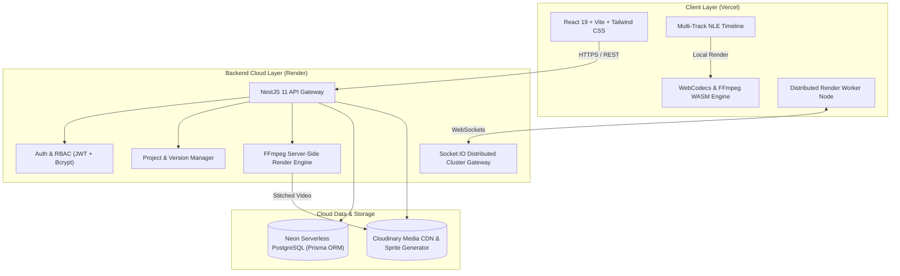

# ClipStudio Pro — Professional Cloud & In-Browser Video Editing Suite

[](https://clipstudio-pro.vercel.app)
[](https://clipstudio-pro.onrender.com)
[](https://clipstudio-pro.onrender.com/api/docs)
[](https://neon.tech/)
[](https://cloudinary.com/)
[](LICENSE)

**ClipStudio Pro** is a full-stack, cloud-connected, non-linear video editing workstation. It pairs a **React 19** browser-based studio featuring hardware-accelerated **WebCodecs** and **FFmpeg WASM** rendering with an industrial-grade **NestJS 11** backend engine supporting **Cloudinary** media streaming, **Neon PostgreSQL** project persistence, server-side **FFmpeg** rendering, and **WebSocket-orchestrated distributed cluster rendering**.

---

## 🌐 Live Deployments

| Component | Service | Live Production URL |
| :--- | :--- | :--- |
| **Frontend Web App** | Vercel | [https://clipstudio-pro.vercel.app](https://clipstudio-pro.vercel.app) |
| **Backend REST & WS API** | Render | [https://clipstudio-pro.onrender.com](https://clipstudio-pro.onrender.com) |
| **Interactive API Documentation** | Swagger / OpenAPI | [https://clipstudio-pro.onrender.com/api/docs](https://clipstudio-pro.onrender.com/api/docs) |

---

## 🔐 Demo Login Credentials

The system comes pre-configured with default credentials for instant evaluation:

| Account Type | Email | Password | Role | Access & Permissions |
| :--- | :--- | :--- | :--- | :--- |
| **Super Admin** | `admin@videostudio.com` | `Admin123!` | `SUPER_ADMIN` | Full administrative control, system metrics, user role management, cluster node monitoring |
| **Demo User** | `user@videostudio.com` | `User123!` | `USER` | Standard video creator: project creation, timeline editing, media uploads, browser & cloud exports |

> 💡 **Public Registration**: Any user can also register a personal account directly through the application's **Sign Up** interface or via `POST /api/auth/register`.

---

## 🏗️ System Architecture



---

## ✨ System Highlights

- **Multi-Track Timeline Editor**: Multi-track composition for video, audio, text, and sticker layers with drag-and-drop, snapping, ripple delete, and split-at-playhead tools.
- **Hybrid Rendering Pipeline**:
  - **In-Browser Hardware Render**: Instant MP4 output using browser WebCodecs API and WebAssembly FFmpeg.
  - **Cloud Render Cluster**: Remote rendering of complex timelines via NestJS and Fluent-FFmpeg on Render.
  - **Distributed Peer Computing**: Connect multiple browser tabs as distributed workers to chunk and render frames concurrently.
- **Cloud Media Asset Management**: Automatic upload to Cloudinary, thumbnail generation, and timeline scrubbing sprite sheets.
- **Enterprise Security & Administration**: Role-based access control (`SUPER_ADMIN`, `ADMIN`, `USER`), JWT session management, and admin diagnostics dashboard.

---

## 📁 Repository Structure

```
clipstudio-pro/
├── frontend/                     # React 19 + TypeScript + Vite Web Application
│   ├── src/
│   │   ├── assets/               # Icons, images, and mock assets
│   │   ├── components/           # Timeline, Player, Properties, Modals, AdminPanel
│   │   ├── lib/                  # Axios API client, utilities
│   │   ├── services/             # WebCodecs, WASM Encoder, Render Worker, Media Manager
│   │   ├── store/                # Redux Toolkit slices (auth, editor, worker, ui)
│   │   └── types/                # TypeScript interfaces & domain types
│   ├── .env.example              # Frontend environment template
│   ├── package.json              # Frontend dependencies and scripts
│   └── README.md                 # Frontend-specific documentation
│
├── backend/                      # NestJS 11 + Prisma Server API
│   ├── prisma/                   # Prisma schema and PostgreSQL migrations
│   ├── src/
│   │   ├── admin/                # Admin user & system metrics controller
│   │   ├── asset/                # Media upload & Cloudinary asset management
│   │   ├── auth/                 # JWT authentication, guards, roles, password hashing
│   │   ├── common/               # Cloudinary service, filters, ffmpeg utilities
│   │   ├── export/               # Fluent-FFmpeg video rendering & export service
│   │   ├── prisma/               # Prisma database service
│   │   ├── project/              # Project timeline CRUD & version management
│   │   └── rendering/            # Socket.IO distributed rendering cluster gateway
│   ├── Dockerfile                # Production multi-stage Dockerfile
│   ├── .env.example              # Backend environment template
│   ├── package.json              # Backend dependencies and scripts
│   └── README.md                 # Backend-specific documentation
│
└── README.md                     # Project overview and quick start guide (this file)
```

---

## 🚀 Quick Start (Local Development)

### 1. Clone Repository
```bash
git clone https://github.com/Ramjanict/clipstudio-pro.git
cd clipstudio-pro
```

### 2. Configure & Start Backend
```bash
cd backend
npm install

# Configure environment variables
cp .env.example .env
# Edit .env with your Neon DATABASE_URL, JWT_SECRET, and Cloudinary keys

# Generate Prisma client and sync database
npx prisma generate
npx prisma db push

# Start backend development server
npm run start:dev
```
Backend will be listening at `http://localhost:3000` (Swagger docs at `http://localhost:3000/api/docs`).

### 3. Configure & Start Frontend
```bash
# In a new terminal window:
cd frontend
npm install

# Configure environment variables
cp .env.example .env
# Set VITE_BACKEND_URL=http://localhost:3000

# Start frontend development server
npm run dev
```
Open your browser at `http://localhost:5173`.

---

## 🚢 Deployment Summary

### Frontend Deployment (Vercel)
- **Root Directory**: `frontend`
- **Framework Preset**: `Vite`
- **Build Command**: `npm run build`
- **Output Directory**: `dist`
- **Environment Variables**: `VITE_BACKEND_URL=https://clipstudio-pro.onrender.com`

### Backend Deployment (Render)
- **Environment**: Docker
- **Build Context**: `./backend`
- **Dockerfile Path**: `Dockerfile`
- **Environment Variables**: `DATABASE_URL`, `JWT_SECRET`, `CLOUDINARY_*`, `PORT=3000`, `SUPER_ADMIN_EMAIL=admin@videostudio.com`

---

## 📄 License
This project is licensed under the [MIT License](LICENSE).
